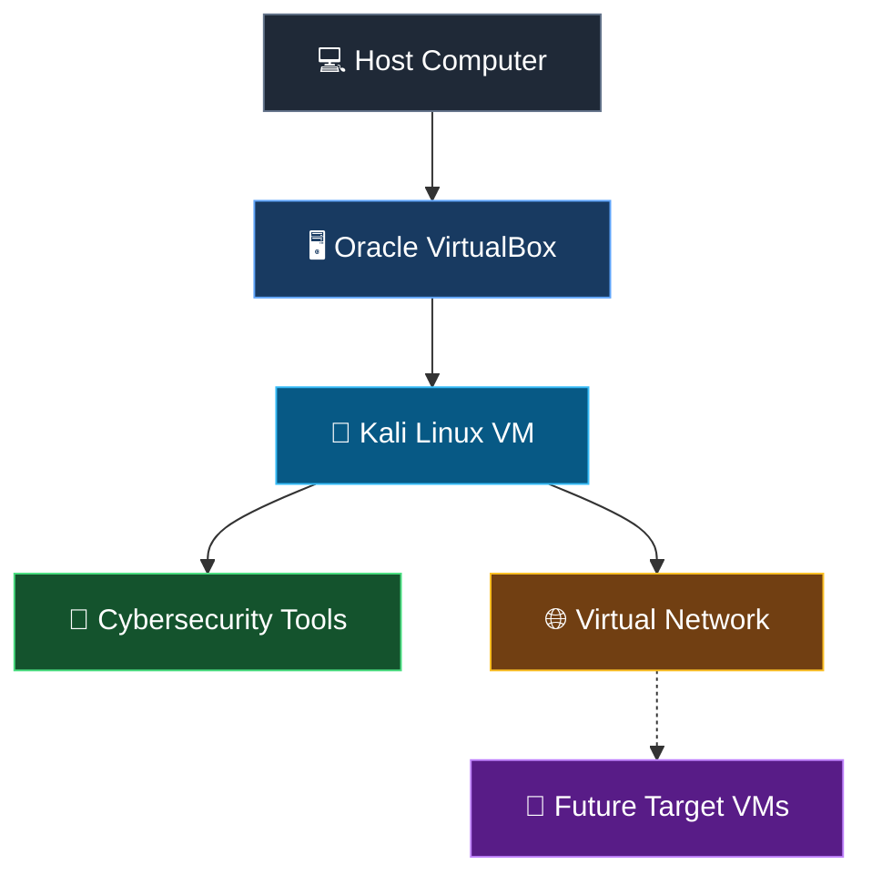

# NETWORKWALKS-B084I-WK1-CYBERSECURITY-LAB-SETUP
Cybersecurity Lab Setup

# 🔐 Cybersecurity Lab Setup | Kali Linux + VirtualBox

<p align="center">
  
  
  
  
</p>

<p align="center">
  <b>A hands-on cybersecurity laboratory built with Kali Linux and Oracle VirtualBox for learning networking, ethical hacking, and security testing in a controlled virtual environment.</b>
</p>

---

## 📌 Project Overview

This project documents the setup and configuration of a virtual cybersecurity lab using **Kali Linux** and **Oracle VirtualBox**.

The purpose of this lab is to create an isolated, flexible, and repeatable environment for exploring cybersecurity concepts, practicing Linux administration, learning network analysis, and performing authorized security assessments.

The lab can be expanded with additional virtual machines to simulate real-world network environments and practice defensive and offensive security techniques safely.

### 🎯 Project Objectives

- Install and configure Oracle VirtualBox.
- Set up Kali Linux as a virtual machine.
- Configure virtual machine hardware and networking.
- Verify network connectivity and system functionality.
- Explore cybersecurity tools and Linux commands.
- Create VM snapshots for recovery and experimentation.
- Document the setup process with screenshots and commands.
- Prepare a foundation for future cybersecurity projects.

---

## 🛠️ Tools & Technologies

| Tool / Technology | Purpose |
| --- | --- |
| 🐉 Kali Linux | Security testing and cybersecurity learning |
| 🖥️ Oracle VirtualBox | Virtualization and VM management |
| 🌐 Virtual Networking | Network connectivity and lab isolation |
| 💻 Linux Terminal | System administration and command-line operations |
| 🔎 Nmap *(optional)* | Network discovery and port scanning |
| 📡 Wireshark *(optional)* | Network traffic analysis |
| 📸 VirtualBox Snapshots | Recovery and configuration management |

> Tools marked optional can be added as your lab develops.

---

## 🏗️ Lab Architecture

The following diagram illustrates the basic lab design.



**Architecture summary:**

- **Host machine:** Runs the virtualization software.
- **VirtualBox:** Provides the virtual hardware and networking.
- **Kali Linux:** Acts as the primary cybersecurity workstation.
- **Virtual network:** Connects lab machines according to the selected network mode.
- **Future target VMs:** Can be added for authorized testing in an isolated environment.

---

## ⚙️ Lab Configuration

Update this table to match your actual setup.

| Component | Configuration |
| --- | --- |
| Host Operating System | `YOUR_HOST_OS` |
| Processor | `YOUR_CPU_MODEL` |
| Installed RAM | `YOUR_TOTAL_RAM` |
| Hypervisor | Oracle VirtualBox |
| Virtual Machine OS | Kali Linux |
| Kali Linux RAM | `YOUR_VM_RAM` |
| Virtual CPUs | `YOUR_VCPU_COUNT` |
| Virtual Disk | `YOUR_DISK_SIZE` |
| Network Mode | `YOUR_NETWORK_MODE` |
| Kali IP Address | `YOUR_KALI_IP` |

> **Note:** Do not publish real public IP addresses, passwords, private keys, or other sensitive system information in your repository.

---

## 🚀 Lab Setup Procedure

### Step 1: Install Oracle VirtualBox

Download and install VirtualBox from the official website.

🔗 [Oracle VirtualBox Downloads](https://www.virtualbox.org/wiki/Downloads)

Verify that hardware virtualization is enabled in your computer's BIOS/UEFI settings if required.

### Step 2: Download Kali Linux

Download the appropriate Kali Linux virtual machine image or installation ISO from the official Kali Linux website.

🔗 [Kali Linux Downloads](https://www.kali.org/get-kali/)

Always obtain installation images from official sources.

### Step 3: Create the Virtual Machine

Open VirtualBox and create or import the Kali Linux virtual machine.

Configure the following resources according to your hardware:

- **Operating system:** Kali Linux
- **Memory:** Allocate sufficient RAM for your host and VM.
- **Processors:** Assign an appropriate number of virtual CPUs.
- **Storage:** Create or configure a virtual disk.
- **Network adapter:** Select the appropriate virtual networking mode.

### Step 4: Configure Virtual Networking

Configure the Kali Linux network adapter according to your lab requirements.

Common VirtualBox networking modes include:

| Network Mode | Typical Use |
| --- | --- |
| NAT | Outbound connectivity through the host |
| NAT Network | Connectivity between VMs on the same NAT network, with outbound access |
| Host-only | Communication between the host and connected VMs |
| Internal Network | Communication between VMs on the same internal network |

**Security recommendation:** Use an isolated lab network for testing vulnerable systems. Understand the limitations of each network mode before connecting target machines.

### Step 5: Start Kali Linux

Start the virtual machine and complete the initial configuration.

After logging in:

- Confirm that the desktop environment loads correctly.
- Open the terminal.
- Check available disk space and memory.
- Update the system using the appropriate Kali Linux package-management procedure.
- Confirm that the network adapter is functioning.

### Step 6: Verify the Configuration

Run the following commands inside Kali Linux.

**Check the operating system:**

```bash
cat /etc/os-release
```

**Check IP addresses and network interfaces:**

```bash
ip addr
```

**Check routing information:**

```bash
ip route
```

**Check connectivity to a permitted destination:**

```bash
ping -c 4 1.1.1.1
```

**Check DNS resolution:**

```bash
getent hosts kali.org
```

**Check available disk space:**

```bash
df -h
```

**Check memory usage:**

```bash
free -h
```

> Expected results depend on your network configuration. A failed ping alone does not necessarily indicate a broken network, because some destinations block ICMP traffic.

### Step 7: Create a Clean Snapshot

Once the operating system and network are working correctly, create a VirtualBox snapshot.

Suggested name:

`Kali-Linux-Clean-Setup`

A snapshot provides a convenient recovery point before making major configuration changes or conducting lab exercises.

---

## 🔎 Verification Checklist

Use this checklist to track your progress.

- [ ] VirtualBox installed successfully
- [ ] Kali Linux VM created or imported
- [ ] Virtual machine starts correctly
- [ ] CPU, RAM, and storage configured
- [ ] Network adapter configured
- [ ] IP address and routing verified
- [ ] DNS resolution tested
- [ ] Required tools installed or verified
- [ ] Clean snapshot created
- [ ] Screenshots captured for documentation

---

## 📸 Screenshots & Documentation

Add screenshots of your actual lab configuration to make this repository more informative and visually appealing.

Suggested folder structure:

```text
cybersecurity-lab/
├── README.md
└── screenshots/
    ├── 01-virtualbox-dashboard.png
    ├── 02-kali-linux-desktop.png
    ├── 03-vm-settings.png
    ├── 04-network-configuration.png
    ├── 05-terminal-verification.png
    └── 06-vm-snapshot.png
```

After adding your screenshots, display them in this section.

### 1. VirtualBox Dashboard


### 2. Kali Linux Desktop


### 3. Virtual Machine Settings


### 4. Network Configuration


### 5. Terminal Verification


### 6. Virtual Machine Snapshot


> Replace these image paths with your actual screenshots. If you have not captured a screenshot yet, remove its image reference until the file is available.

---

## 🧪 Future Lab Experiments

This environment can be extended through additional authorized cybersecurity exercises.

| Area | Possible Experiment |
| --- | --- |
| Linux Administration | Users, permissions, processes, and services |
| Networking | IP addressing, routing, DNS, and connectivity |
| Reconnaissance | Host discovery and service identification |
| Packet Analysis | Capture and inspect lab traffic |
| Vulnerability Assessment | Assess intentionally vulnerable lab machines |
| Web Security | Practice against a local test application |
| Defensive Security | Review logs and investigate suspicious activity |
| Lab Automation | Document repeatable configuration steps |

These are potential future activities, not claims that every exercise has already been completed.

---

## 🐞 Troubleshooting

### Issue 1: Virtual Machine Does Not Start

**Possible causes:**
- Hardware virtualization is disabled.
- Insufficient memory is available.
- A virtualization or hypervisor configuration conflict exists.

**Troubleshooting:**
1. Check the BIOS/UEFI virtualization settings.
2. Review the VirtualBox error message.
3. Ensure the host has enough available resources.
4. Consult the official VirtualBox documentation.

### Issue 2: No Network Connectivity

**Possible causes:**
- Incorrect network adapter configuration.
- The virtual network is not configured correctly.
- DNS or gateway settings are incorrect.

**Troubleshooting commands:**

```bash
ip addr
ip route
cat /etc/resolv.conf
```

Review the VirtualBox adapter settings and verify connectivity to an appropriate destination.

### Issue 3: Kali Linux Runs Slowly

**Possible solutions:**
- Allocate appropriate RAM and CPU resources.
- Close unnecessary applications on the host.
- Check free disk space.
- Review the VM's display and storage settings.

---

## 📚 Key Learnings

This project provides practical experience with:

- Virtualization and virtual machine management.
- Kali Linux installation and basic administration.
- Virtual networking and IP configuration.
- Linux terminal commands and connectivity checks.
- VM snapshots and recovery planning.
- Cybersecurity lab documentation.
- Safe experimentation in a controlled environment.

Add any additional concepts or troubleshooting lessons you personally learned while building the lab.

---

## 🔐 Security & Ethical Use

This laboratory is intended for **educational purposes and authorized security testing only**.

- Test only systems that you own or have explicit permission to assess.
- Keep vulnerable target machines on an appropriately isolated network.
- Do not expose intentionally vulnerable services to public networks.
- Avoid storing credentials, private keys, tokens, or sensitive personal data in the repository.
- Follow applicable laws, organizational policies, and responsible disclosure practices.

---

## 🔗 Official Resources

- [Kali Linux](https://www.kali.org/)
- [Kali Linux Documentation](https://www.kali.org/docs/)
- [Oracle VirtualBox](https://www.virtualbox.org/)
- [VirtualBox User Manual](https://www.virtualbox.org/manual/)
- [Nmap Documentation](https://nmap.org/book/man.html)
- [Wireshark Documentation](https://www.wireshark.org/docs/)

---

## 👨‍💻 Author

**Your Name**

Aspiring Cybersecurity Professional | Cybersecurity Lab Projects

- GitHub: [@YOUR_GITHUB_USERNAME](https://github.com/YOUR_GITHUB_USERNAME)
- LinkedIn: [YOUR_LINKEDIN_PROFILE](https://www.linkedin.com/)

---

## ⭐ Support & Contributions

If you find this project useful for learning cybersecurity and virtualization, consider giving the repository a ⭐.

Suggestions, improvements, and constructive feedback are welcome.

---

<p align="center">
  <b>🔐 Learn. Build. Test. Secure.</b>
  <br/>
  <sub>Building practical cybersecurity skills, one lab at a time.</sub>
</p>


